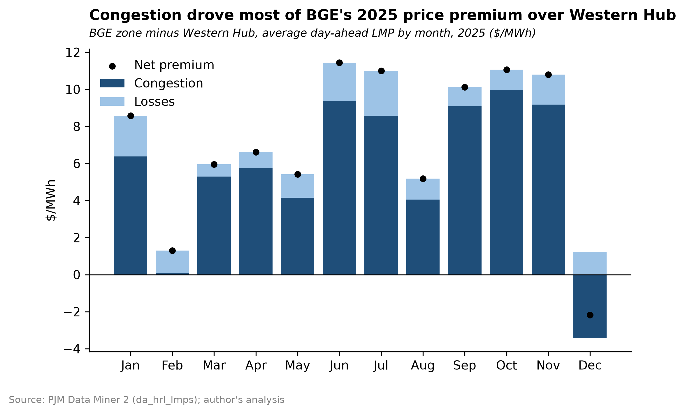
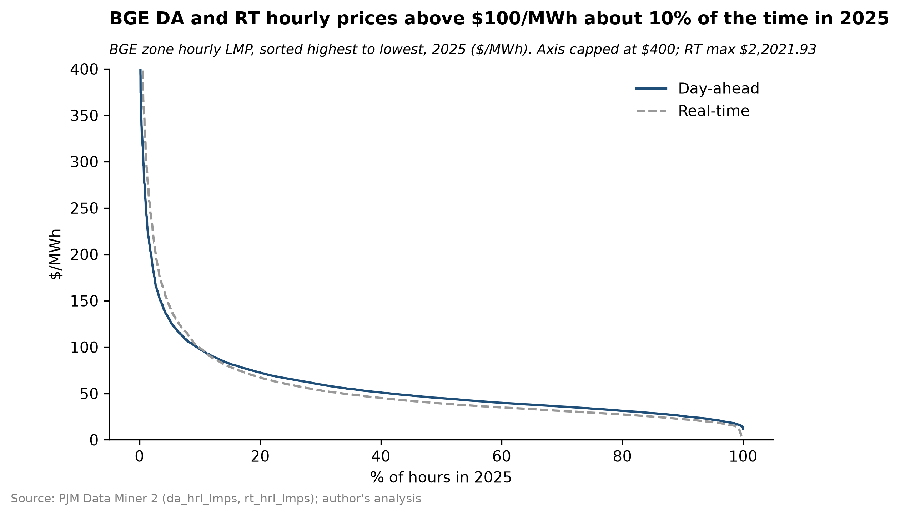
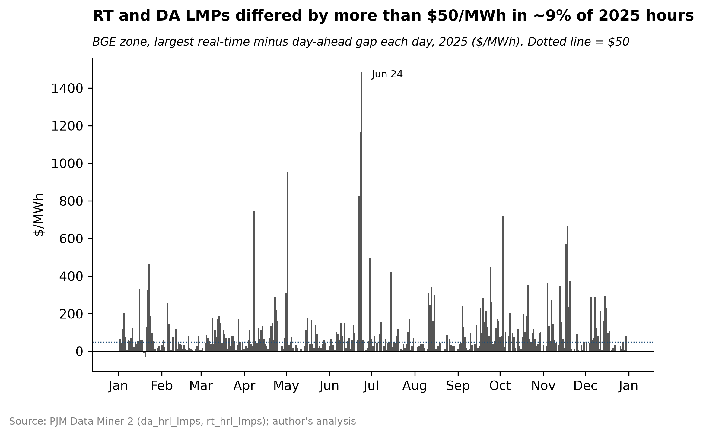

# BGE Zone Price Analysis (2025)

How did 2025 wholesale electricity prices in the BGE zone (central Maryland) compare with PJM's Western Hub, how much of the difference came from transmission congestion versus losses, and how closely did real-time prices follow day-ahead?

**Status:** Version 0.1. This is the first project in a self-directed curriculum in Python data analysis for energy markets. A follow-on version will estimate the arbitrage value of a 4-hour battery in the BGE zone and separate the share attributable to local congestion.

## Findings

**1. BGE's day-ahead price averaged $7.13/MWh above Western Hub, mostly from congestion.** About 80% of the average premium ($5.72/MWh) came from the congestion component and about 20% ($1.41/MWh) from losses. The premium varied widely by month, from $1.30/MWh in February to $11.44/MWh in June. In December, the congestion component favored BGE with a monthly average of -$2.18/MWh.

**2. Real-time and day-ahead price distributions at BGE were similar except at the extreme top.** Day-ahead prices ranged from $11.91 to $609.74/MWh. Real-time prices reached $2,022/MWh. Comparing the two distributions percentile by percentile, they were within $28/MWh about one standard deviation of the gap of each other except in the highest-priced ~3% of hours.

**3. Real-time and Day-ahead prices rose above $100/MWh for about 10% of 2025 hours.**

**4. Hour by hour, real-time and day-ahead differed by more than $50/MWh in about 9% of hours.** Real-time exceeded day-ahead by $50+ in 4.9% of hours. The largest gaps clustered in a few events; the biggest was on June 24, when real-time exceeded day-ahead by about $1,482.90/MWh.

## Data

Source: PJM Data Miner 2 (dataminer2.pjm.com), downloaded manually on [dates].

- Day-ahead hourly LMPs (`da_hrl_lmps`) and real-time hourly LMPs (`rt_hrl_lmps`)
- Nodes: BGE (zone, pnode ID 51292) and WESTERN HUB (hub, pnode ID [ID])
- Period: January 1 to December 31, 2025, all 8,760 hours
- Filtered by Pnode Name. Filtering by Zone returns every pricing node inside the zone.
- The date range must run through the end of December 31. Ending at "12/31/2025" returns only the first hour of that day.

Raw files go in `data/raw/` and are not tracked in Git. Re-download using the settings above.

## Method

- Loaded each file with explicit timestamp formats, kept only current rows, and indexed on UTC. Eastern time is used only for calendar grouping and labels, because daylight saving time makes one Eastern hour repeat in November and one disappear in March.
- Validated each file with assert checks: 8,760 rows per node and market, no duplicate timestamps, no missing prices.
- Combined all four series into one long table and checked that energy + congestion + losses = LMP in every hour, and that the energy component is identical at both nodes. Because energy is identical, the BGE-to-hub spread is entirely congestion and losses.
- Hourly comparisons match day-ahead and real-time prices on UTC timestamps.

## Limitations

- **This compares prices, not costs.** The cost to BGE customers depends on how much energy is bought in each hour, and on how much congestion revenue is returned to load through Auction Revenue Rights and Financial Transmission Rights. Neither is analyzed here.
- **Averages are unweighted.** A load-weighted premium would better reflect the impact on customers.
- **Zone and hub prices are averages over many buses.** A specific site's prices depend on its own node.
- **One year of data.** 2025 may not be typical.
- **Descriptive only.** The analysis shows when prices diverged, not why. Explaining individual spikes would require outage, load, and weather data.

## Next steps

- Estimate the arbitrage value of a 4-hour battery at BGE vs. Western Hub, and the share attributable to local congestion
- Load-weight the premium using BGE hourly load
- Compare hour-by-hour RT minus DA patterns by hour of day and season

## Repository structure

- `notebooks/01_load_clean.ipynb`: loading, cleaning, validation, combined table
- `notebooks/02_exhibits.ipynb`: analysis and charts
- `exhibits/`: final charts (PNG and SVG)

## How to run

Download the data as described above into `data/raw/`, then run the notebooks in order with a conda environment containing Python, pandas, matplotlib, and pyarrow.